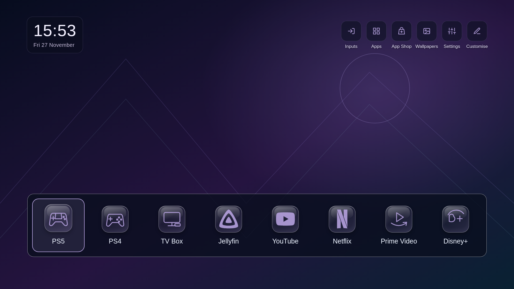

# NeonDeck for webOS

A console-style Home screen for rooted LG TVs, built on [CleanYourTV](https://github.com/lasharor/cleanyourtv-WebOS). Matching icons, real video wallpapers, seasonal playlists and a Homebrew app shop run on the TV. Your computer can be switched off after installation.



*Browser preview with sample apps and original geometric artwork. TV setup varies.*

- Wallpaper browsing with a left or right preview, optional animated preview and background downloads.
- HD 720p, Full HD 1080p and opt-in 4K downloads where the original video supports them. Lower-resolution files are never enlarged to pretend to be 4K.
- Wallpaper deletion, preview-cache cleanup, app removal and warnings based on actual free TV storage.
- Multiple wallpapers per holiday, configurable Christmas dates and Bulgarian Orthodox Easter timing. New Year and Halloween are optional. Automation starts off.
- Auto Theme matches Home icon colours to the selected wallpaper locally, with a saved manual override. Twelve icon styles, five focus animation choices, sizes, outlines, corners, dock opacity, clock size, image fit and dimming.
- A visual Theme Studio and card-based App Shop with category tabs and remote navigation.
- One themed shop for the official webOS Homebrew catalogue: browse, install, update, open and remove apps. Commercial streaming apps still require their normal installation and accounts.
- Per-TV credentials, local-only helper services, preserved input labels and saved preferences, installation backup and rollback.

**Installable release v0.3.1. Tested on LG 55UR73003LA, firmware 33.31.75, webOS 25.** Other models need the checks in [Compatibility](docs/COMPATIBILITY.md). Root access, an aarch64 kernel, Node 16.20+ and the reviewed CleanYourTV frontend are required. Developer Mode alone cannot replace Home. This release cannot promise support for every LG TV.

For installation using the remote, follow [TV-only setup and USB repair](docs/TV-SETUP.md). Get the setup IPK and USB ZIP from [Releases](https://github.com/helldragonpz/neondeck-webos/releases/latest). The USB route needs the setup app already installed; stock LG media apps cannot run it.

Version 0.2.0 adds immediate pointer previews, reused menu rows for faster focus movement, optional wallpaper pausing in menus, short button animations with an Off choice, and Clean/Glass/Large/Analogue clock styles. Clock date, 12/24-hour format, seconds, language, position and timezone are configurable.

Start with the [illustrated installation guide](docs/INSTALL.md). Read [Privacy](docs/PRIVACY.md), [Recovery](docs/RECOVERY.md) and [validation details](docs/VALIDATION.md) before installing. The public package contains no owner network settings, keys, downloaded wallpaper artwork or videos.

Build and test locally with Python 3.10+ and Node 16.20+:

```sh
python3 build.py
node tests/core.cjs
python3 -m unittest discover -s tests -p 'installer.py'
python3 tools/audit_public.py
```

NeonDeck code is MIT licensed. Upstream licenses and artwork credits are in [THIRD-PARTY.md](THIRD-PARTY.md). This project is independent of LG, Apple, Sony and the services shown.

Version 0.2.1 repairs long 4K wallpaper conversions: duration-based time budgets, a bounded 320 MiB conversion worker, protected active posters, correct widescreen quality checks, retained errors and retry without downloading a complete source again. Clear preview cache also removes the retained retry source.

Version 0.3.0 introduces Auto Theme, a local wallpaper-colour matcher with a saved manual override, eight icon finishes and five icon animation choices. Theme Studio and App Shop use visual cards, category tabs and remote-friendly navigation. App details and installation/removal confirmations remain separate steps.

Version 0.3.1 adds distinct pixel, filled and duotone artwork alongside the original line icons, and introduces Sticker, Metal and Hologram materials. All twelve styles have three-icon previews on one screen. Dock and Apps grid rendering now share the same style rules, including circular Orbit frames.
