# Illustrated installation

Prefer installation using only the TV remote? Start with [TV-only setup and USB](TV-SETUP.md). The SSH instructions below remain available for development and recovery.

Allow about 20–30 minutes after root access is working. You need a computer with Python 3.10+, OpenSSH (`ssh` and `scp`), and the TV on the same trusted network. Linux is tested; Windows users can use WSL. Keep the SSH key on your computer.

Images labelled “illustration” explain the process; LG menu names vary with firmware and region. App screenshots use sample data and original artwork. No screen in this guide exposes an owner's address or credentials.

## 1. Check your exact TV and firmware

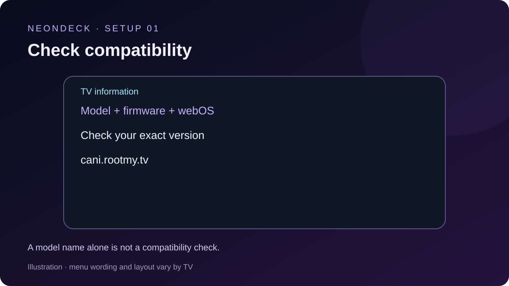

Open the TV's **All Settings** and find **TV Information** and **Software Update**. Record the model, firmware and webOS version locally. Read [Compatibility](COMPATIBILITY.md). Do not update the firmware to try to make this installer work.

Use the model and firmware checker at [Can I Root My TV?](https://cani.rootmy.tv/). Root availability changes between firmware versions, even within one model family. If your version has no supported root method, stop here; an external Android/Google TV or Apple TV device remains an option.

## 2. Establish root and Homebrew Channel

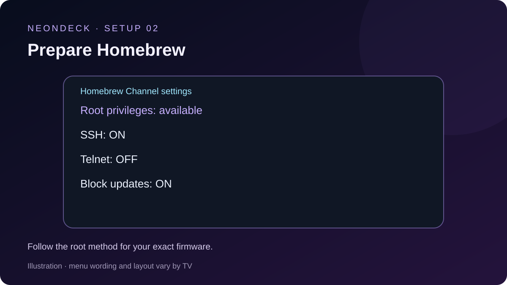

Follow the method linked by the checker and the [webOS Homebrew rooting guide](https://www.webosbrew.org/rooting/). Rooting is a separate, device-specific prerequisite; NeonDeck performs no firmware flashing or rooting.

Open **Homebrew Channel → Settings**. Confirm the channel is running with root privileges, enable **SSH**, and leave **Telnet** disabled. If you want to preserve root, enable its update blocking option and turn off automatic software updates in LG's settings. A manual update or factory reset can still remove modifications.

## 3. Connect privately over SSH

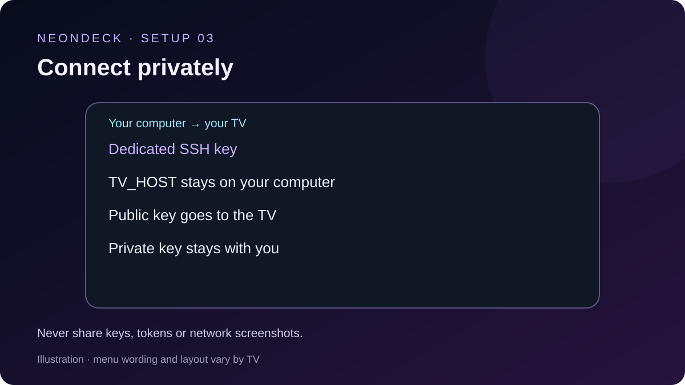

Find your TV address in its network settings. In the commands below, replace `TV_HOST` with that address. Do not post it in an issue or screenshot. `TV_HOST` is a placeholder, not a real address.

On your computer, create a dedicated key and provision its **public** half:

```sh
ssh-keygen -t ed25519 -f ~/.ssh/neondeck_tv
ssh-copy-id -i ~/.ssh/neondeck_tv.pub root@TV_HOST
ssh -i ~/.ssh/neondeck_tv root@TV_HOST
```

On the first connection, confirm that you are connecting to your own TV before accepting its host key. Enter any initial Homebrew SSH password only in your local terminal; see the [Homebrew Channel documentation](https://github.com/webosbrew/webos-homebrew-channel#readme). If your key has a passphrase, load it with `ssh-add ~/.ssh/neondeck_tv` before running the installer.

At the TV shell, check:

```sh
id -u
uname -m
node --version
```

Expected: `0`, `aarch64`, and at least `v16.20`. Older Node or a 32-bit-only kernel is unsupported by this release. Do not replace the TV's system Node binary.

## 4. Install the reviewed CleanYourTV baseline

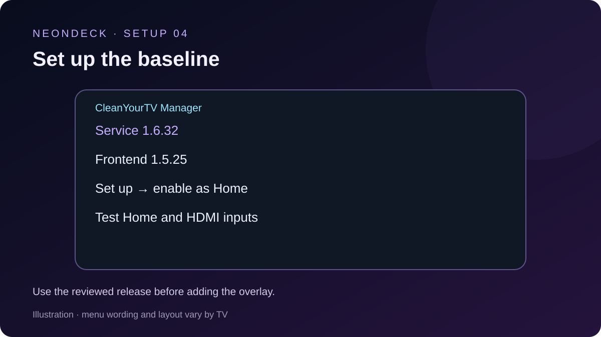

This release uses **CleanYourTV manager/service 1.6.32 and frontend 1.5.25**. If you already have that baseline working as Home, skip the installation command. For another version, stop and review compatibility first.

In the **TV SSH shell**, use Homebrew Channel's verified package installer:

```sh
luna-send -i luna://org.webosbrew.hbchannel.service/install '{"id":"com.cleanyourtv.manager","ipkUrl":"https://github.com/lasharor/cleanyourtv-WebOS/releases/download/v1.6.32/com.cleanyourtv.manager_1.6.32_all.ipk","ipkHash":"0202b7fda9ec257e5131f8a9d888f590127f82474c789ce0a705ba2a3cd787e5","subscribe":true}'
```

Wait for `"finished":true`, then press Ctrl+C if the subscription remains open. The URL and SHA256 refer to the [reviewed release](https://github.com/lasharor/cleanyourtv-WebOS/releases/tag/v1.6.32).

On the TV, open **CleanYourTV**, choose its setup options and enable its Home takeover. Test that the Home button opens CleanYourTV and that your HDMI devices still work. Review its optional debloat choices separately; this overlay preserves those choices. Exit the SSH shell with `exit` to return to your computer.

## 5. Download NeonDeck and run the check

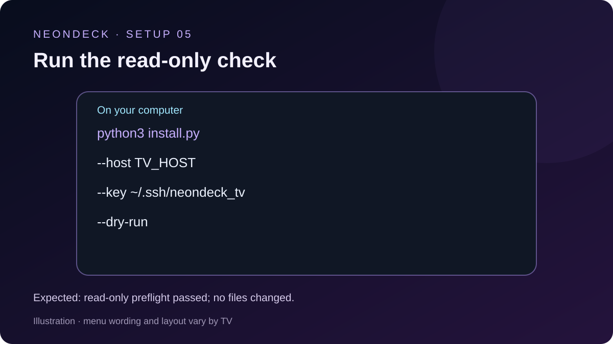

Download this repository using GitHub's **Code → Download ZIP**, extract it, and open a terminal in the folder containing `install.py`. Run on your **computer**:

```sh
python3 install.py --host TV_HOST --key ~/.ssh/neondeck_tv --dry-run
```

The read-only check requires root, a compatible runtime, a reviewed frontend, CleanYourTV enabled as Home and at least 160 MB free in system storage. It also checks for active downloads or app operations. Resolve a failed check before proceeding. There is no force option.

## 6. Install the overlay

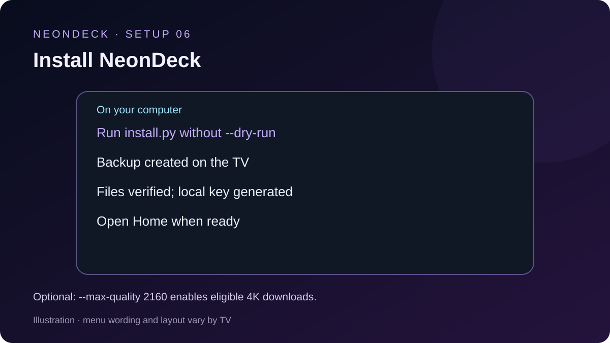

Wait for downloads and app installations to finish. Run on your **computer**:

```sh
python3 install.py --host TV_HOST --key ~/.ssh/neondeck_tv
```

For an eligible 4K TV, opt in to the extra 4K wallpaper choice with:

```sh
python3 install.py --host TV_HOST --key ~/.ssh/neondeck_tv --max-quality 2160
```

Default maximum is 1080p. Download quality still depends on the original source and available storage. Converting 4K on the TV takes longer and uses more resources.

The installer creates a private backup on the TV, verifies the converter checksum, generates a device-local secret and installs boot hooks. It refreshes Home if Home is on screen. A foreground game or streaming app stays open; return to Home when ready. Use `--no-reload` to stage the UI without refreshing Home.

## 7. Arrange inputs and customise Home

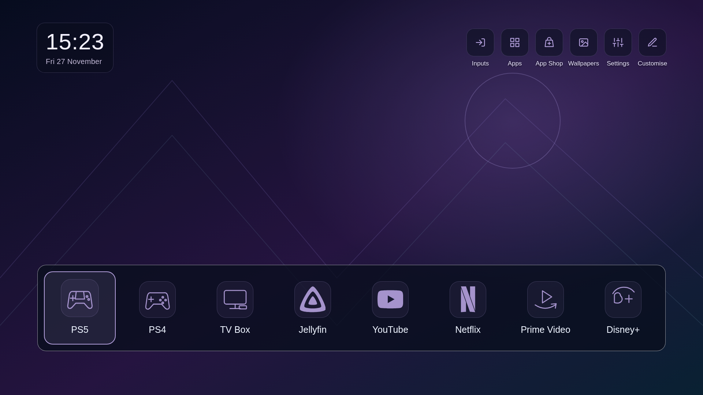

Use **Customise → More launcher settings** to arrange your dock and top buttons. Input icons follow their titles: rename a console input to `PS4` or `PS5` to select its matching glyph. Pick your own HDMI order; no owner's input mapping is shipped.

Open **Customise** for the visual **Theme Studio**. Use Look, Icons, Layout, Clock and More to browse setting cards. Auto Theme follows the selected wallpaper; choosing a manual colour turns matching off until you enable it again. Icon finishes and animations have previews. **Preview panel side** chooses left or right. Settings are saved locally. Existing Prime Video and Disney+ apps can be pinned like other installed apps; NeonDeck does not supply subscriptions or their packages.

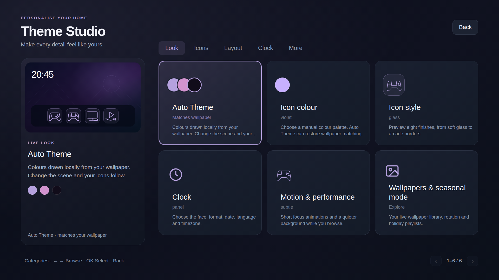

## 8. Preview and download a wallpaper

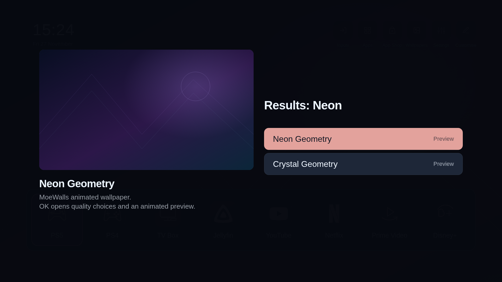

Open **Wallpapers → Search & download wallpapers** and choose a category or type a search. Move focus through results to see the side preview. Press **OK** for the optional animated preview and available quality choices. During a download the poster remains visible. **Continue browsing** leaves the job running; **Cancel download** stops it. **Wallpapers → Download status / retry** reopens progress or retained errors. A failed conversion offers Retry and an HD 720p fallback.

Choose a downloaded video under **My wallpapers**. Rotation can be off or every 5, 15, 30 or 60 minutes. Videos are silent and stop when Home loses focus so games and streaming apps can use the decoder. The first public installation starts with an empty gallery; choose artwork from the source rather than redistributing it with this project.

## 9. Choose holiday playlists

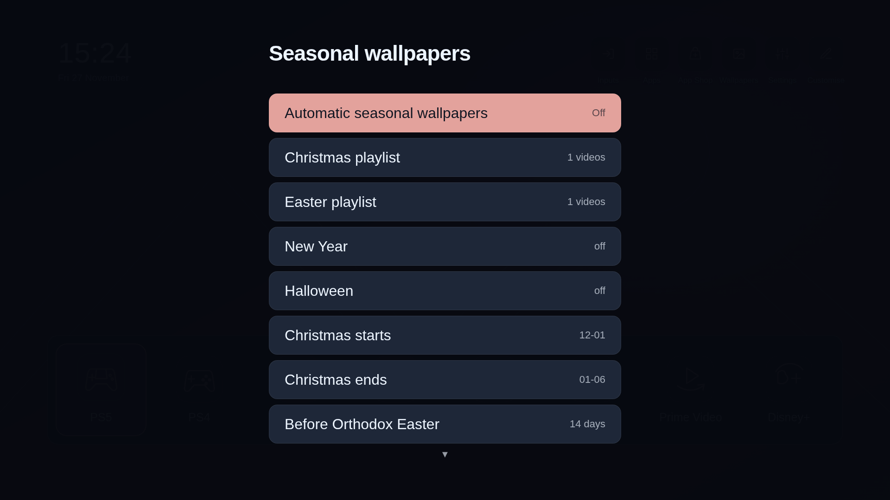

Open **Wallpapers → Seasonal wallpapers**. Download more videos through **Find more holiday wallpapers**, then include them in the Christmas, Easter, New Year or Halloween playlist. You can include more than one video. Set your timezone, Christmas dates and days before/after **Orthodox Easter**. Europe/Sofia is the default timezone.

Enable **Automatic seasonal wallpapers** when ready. New Year and Halloween each have their own switch. Turn automation off to return to your normal wallpaper. Picking a wallpaper manually during an active season also turns seasonal mode off. Deleting a video does not restore it at the next boot.

## 10. Use the shop and manage space

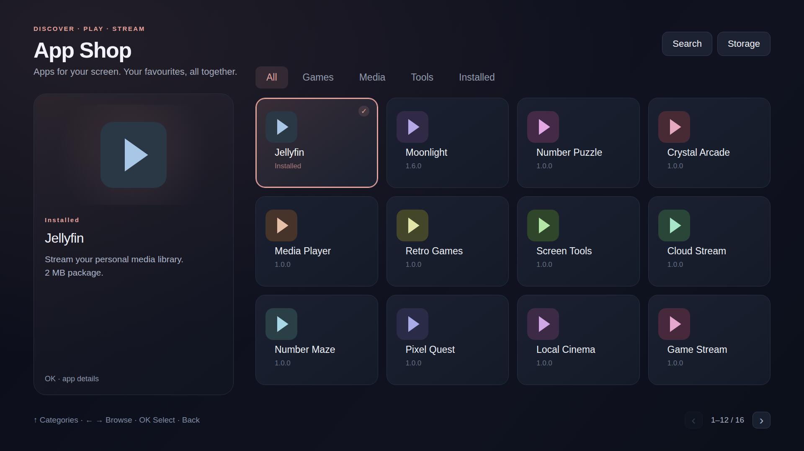

Open **App Shop** for the official Homebrew catalogue. Browse the app cards under All, Games, Media, Tools or Installed, or use Search. Left/Right moves between cards; Up from the first row reaches the category tabs. Down returns to the cards. Pages advance as you move through the grid. Open an app's details before choosing Install, Update or Delete. Packages are installed through Homebrew Channel with the catalogue's SHA256 checksum. Core system apps and a currently running app cannot be removed here.

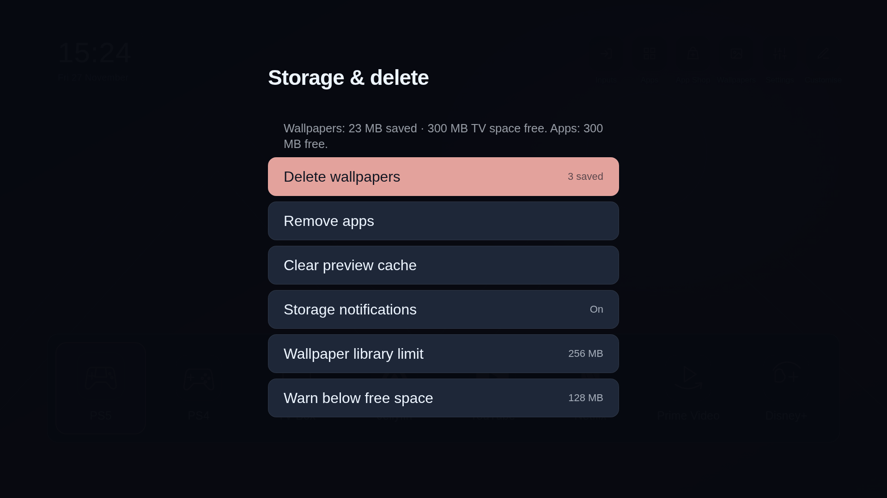

Open **Wallpapers → Storage & delete** for physical free space, library size, wallpaper deletion, removable apps and preview-cache cleanup. Warnings start below 128 MB free or at 90% usage by default. You can adjust the warning threshold and the wallpaper budget. Deletion always requires confirmation in the UI. A 64 MB reserve helps prevent downloads filling system storage.

## 11. Keep a recovery route

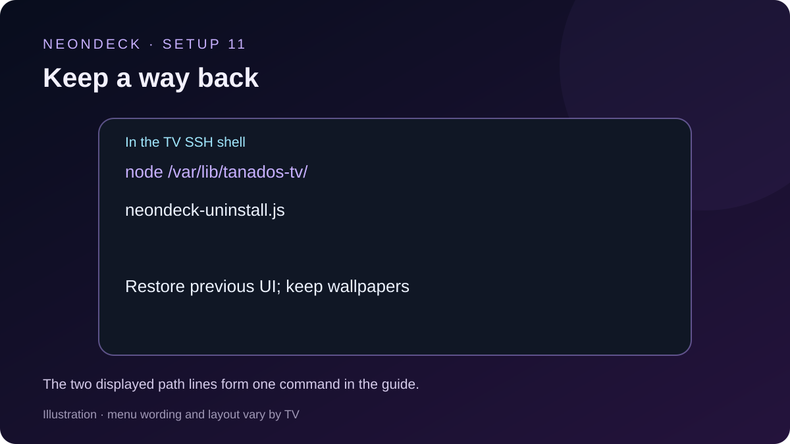

Save [Recovery](RECOVERY.md) before making further changes. To restore the previous UI and service configuration, run in the **TV SSH shell**:

```sh
node /var/lib/tanados-tv/neondeck-uninstall.js
```

This keeps saved wallpapers. To return completely to LG Home, use CleanYourTV's own disable/uninstall controls after rolling back the overlay. No full TV reboot is needed for a normal NeonDeck install or rollback.
