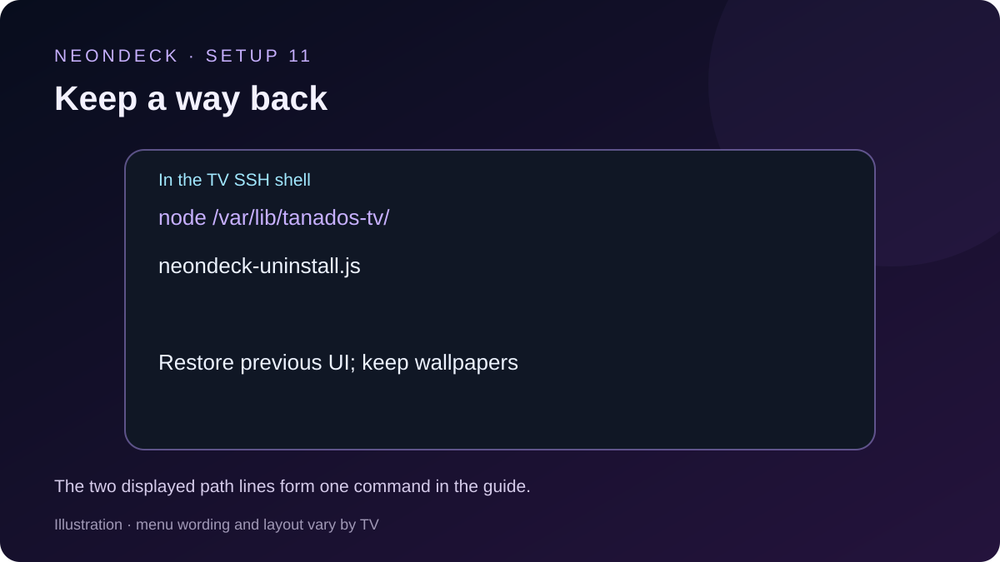

# Recovery



Run these commands in a root SSH shell on your TV. Keep credentials local.

Restore the configuration and service files saved immediately before the first NeonDeck installation:

```sh
node /var/lib/tanados-tv/neondeck-uninstall.js
```

The backup is `/var/lib/tanados-tv/neondeck-backup/`. Rollback preserves wallpaper files. If CleanYourTV existed before NeonDeck, its previous UI returns. To restore LG Home afterwards, use CleanYourTV Manager's own Home disable or uninstall action.

To prevent NeonDeck's hooks from running on the next boot:

```sh
touch /var/lib/tanados-tv/DISABLE-PERSONAL-UI
systemctl stop tanados-media.service tanados-management.service
```

The flag stops the overlay's hooks; the existing Home mount can still show the last staged UI until rollback or CleanYourTV is disabled. Remove the flag only when you intend to enable the hooks again:

```sh
rm /var/lib/tanados-tv/DISABLE-PERSONAL-UI
```

If storage is low, use **Wallpapers → Storage & delete**, remove large wallpapers or unused user apps, and clear the preview cache. Avoid deleting system files or the recovery directory to gain space. If a wallpaper job stalls, cancel it in the UI; a service restart is a fallback after checking that no download should be preserved:

```sh
systemctl restart tanados-media.service
```

If firmware or the baseline launcher changes, review compatibility before reinstalling. An unknown frontend is deliberately not overwritten by the restore hook. Do not bypass the model/firmware check to make an untested update start.
