# NeonDeck on a real LG TV

These are unedited 1920×1080 display captures from an LG **55UR73003LA**, firmware **33.31.75**, webOS 25, running NeonDeck **0.4.0** on 27 November 2026. They show the personalised test TV. Other owners choose their own apps, inputs and wallpapers; the installer starts with an empty wallpaper library.

## Home

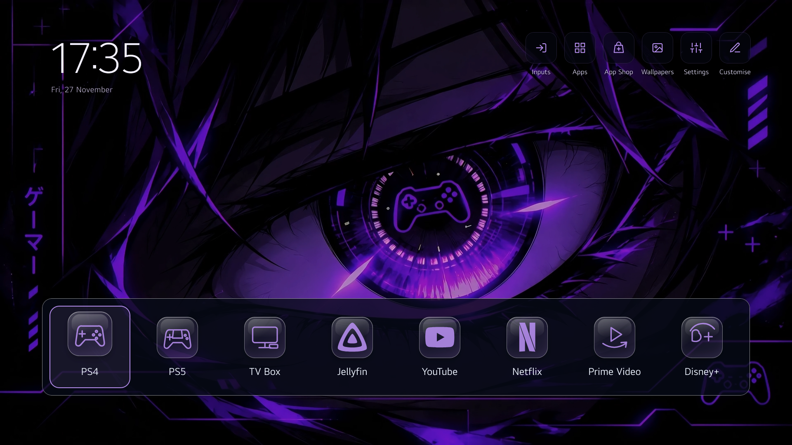

HDMI shortcuts and streaming apps share the selected icon finish. Auto Theme draws the accent colour locally from the wallpaper preview. The background is a frame of a playing video.

## Theme Studio and icon finishes

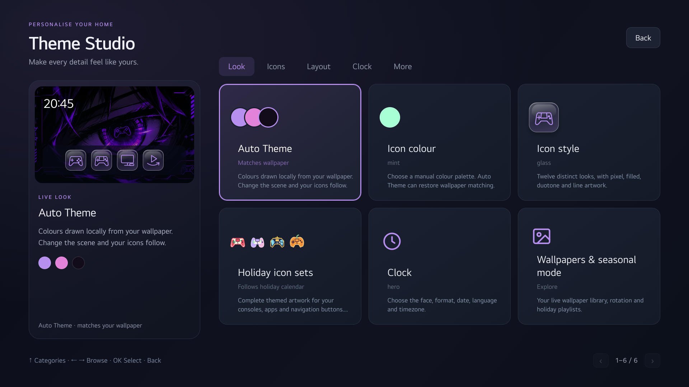

Open **Customise** to change colours, icon finishes, clock, layout, animations and holiday artwork.

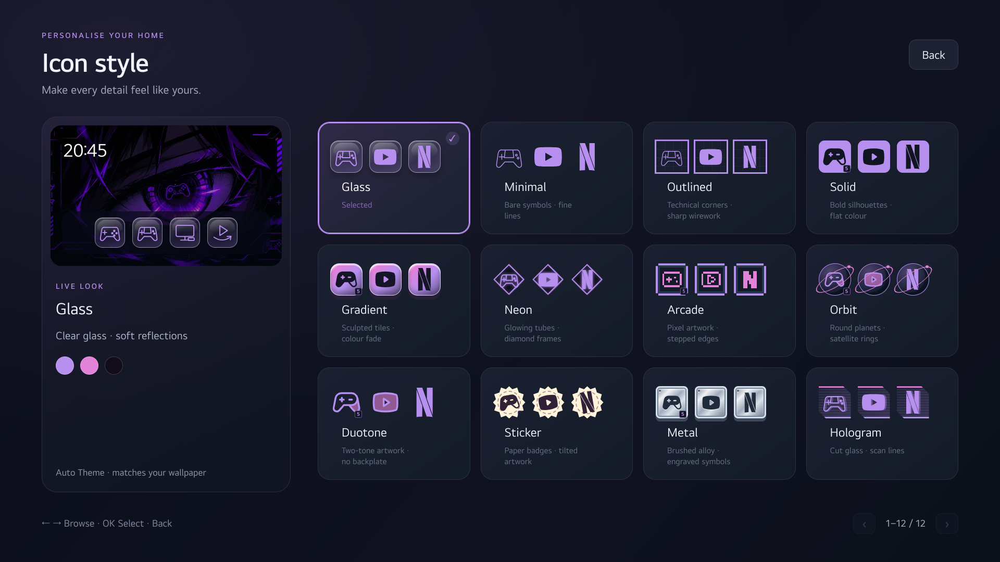

**Icon style** displays all twelve finishes together, with console, YouTube and Netflix samples. Pixel, filled, line and duotone artwork use different materials and frame shapes.

## Four complete holiday icon sets

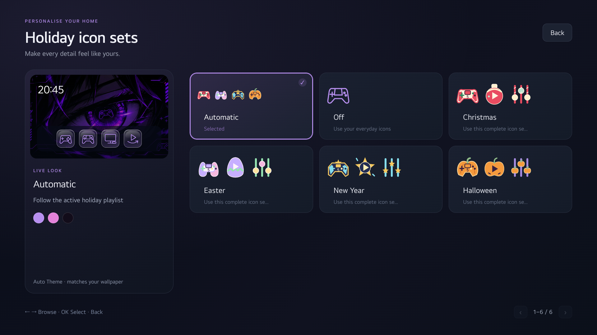

Open **Customise → Holiday icon sets**. **Automatic** follows the active seasonal wallpaper playlist. **Off** restores everyday icons. A named holiday replaces the console, app and navigation artwork immediately, until you choose another option. Your icon finish and wallpaper accent preferences remain saved.

The following appearances were selected manually to demonstrate the four sets in November. They keep the same wallpaper to make the icon designs easy to compare. Automatic was restored after the captures.

### Christmas

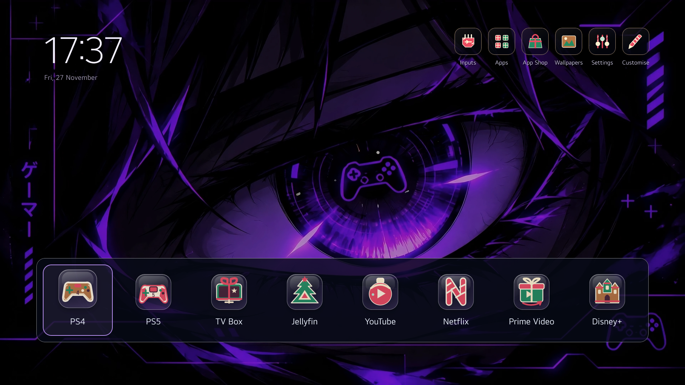

Gingerbread and festive controllers, gift-wrapped TV, bauble play icon, candy-striped Netflix lettering, a fir-tree Jellyfin icon and a gingerbread castle. Navigation uses gift tiles, candy sliders and a striped pencil.

### Easter

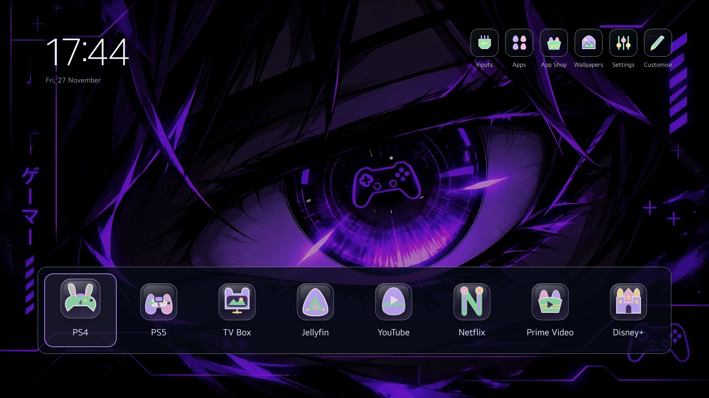

Rabbit and egg-shaped controllers, pastel app artwork, egg baskets, blossoms and spring navigation symbols.

### New Year

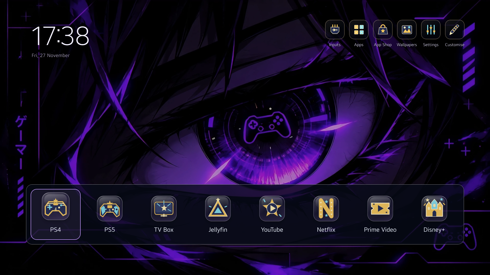

Gold and blue controllers, starburst playback, marquee lettering and celebration-themed navigation.

### Halloween

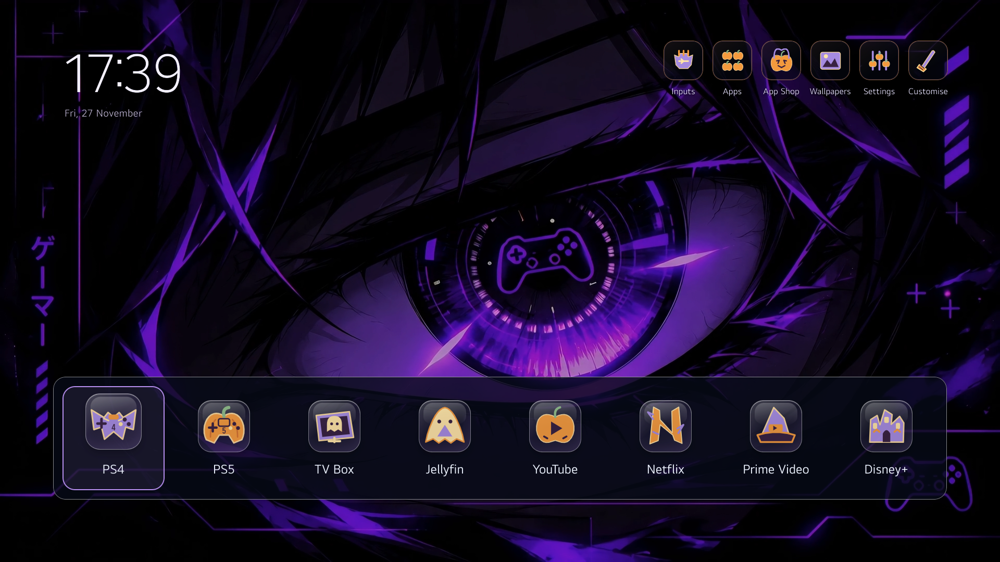

Bat and pumpkin controllers, carved playback, ghost and haunted-castle artwork, a pumpkin shop bucket and a broom for Customise.

## App Shop

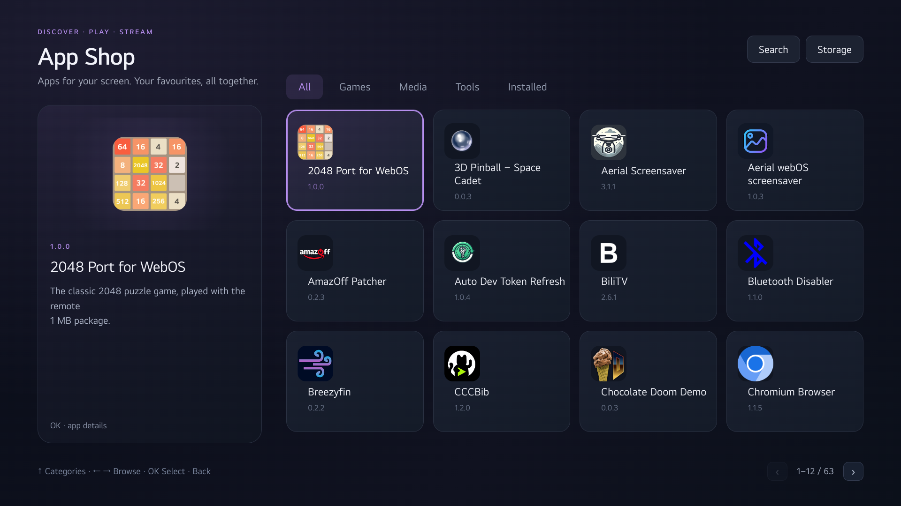

Browse **All, Games, Media, Tools** and **Installed** with the remote or pointer. **OK** opens app details; installing or removing a package requires confirmation. Catalogue contents and versions can change.

## Wallpapers and seasonal playlists

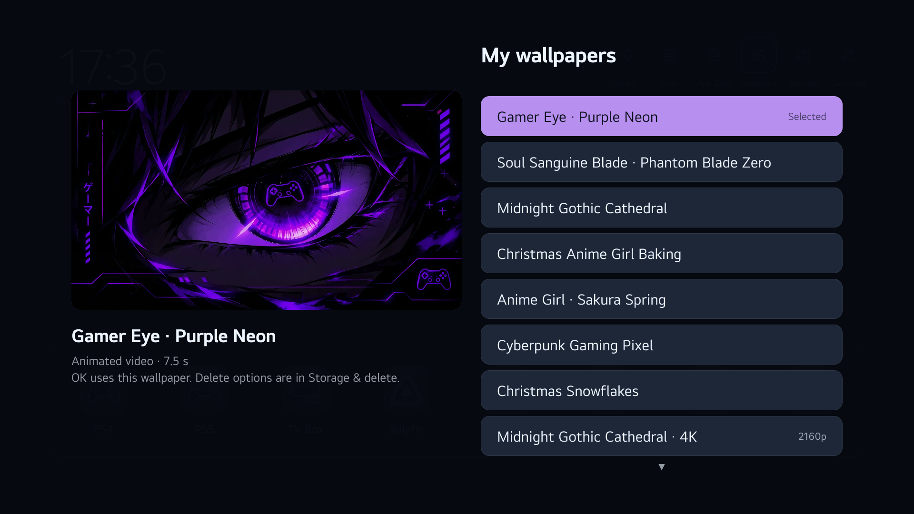

**Wallpapers → My wallpapers** previews the focused video beside the list. Search/download, quality selection, deletion and storage controls are available from the Wallpapers menu.

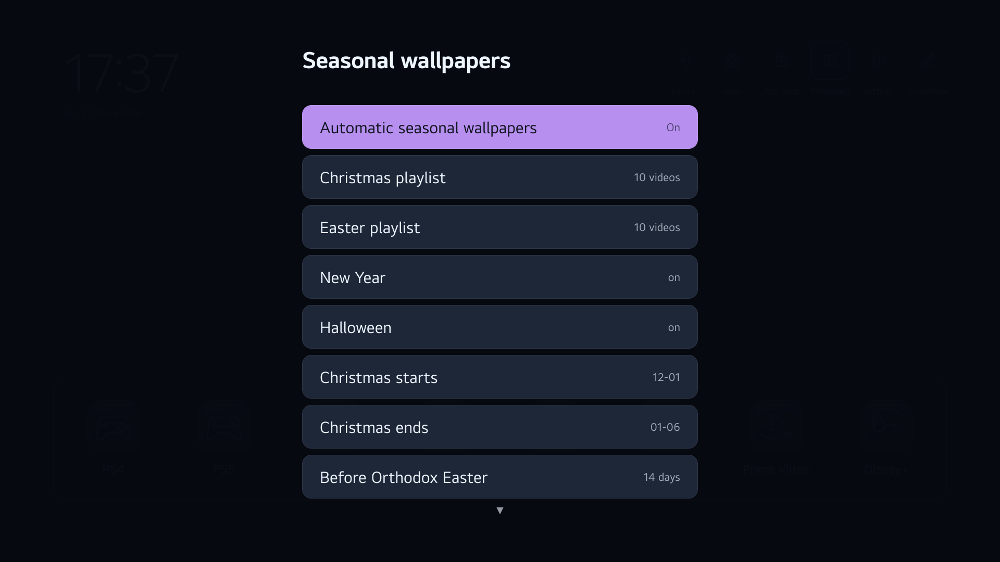

The test TV has ten videos per holiday playlist. These are owner-downloaded examples, not bundled content. Christmas dates, Orthodox Easter timing, New Year, Halloween and timezone settings control when playlists run.

## Screenshot credits

The optional background shown in these interface captures is **[Gamer Eye · Purple Neon, via MoeWalls](https://moewalls.com/anime/gamer-eye-purple-neon-live-wallpaper/)**. Background artwork and app logos remain their respective owners' work and are not relicensed under NeonDeck's MIT licence. The wallpaper video and standalone artwork are not distributed with this project. App Shop imagery comes from the [official Homebrew catalogue](https://repo.webosbrew.org/); see [third-party credits](../THIRD-PARTY.md).

Screenshots under `images/tv/` are real-TV captures. Other images labelled illustrations or browser previews remain separate examples. The captures were reviewed for network addresses, credentials and account information before publication.
