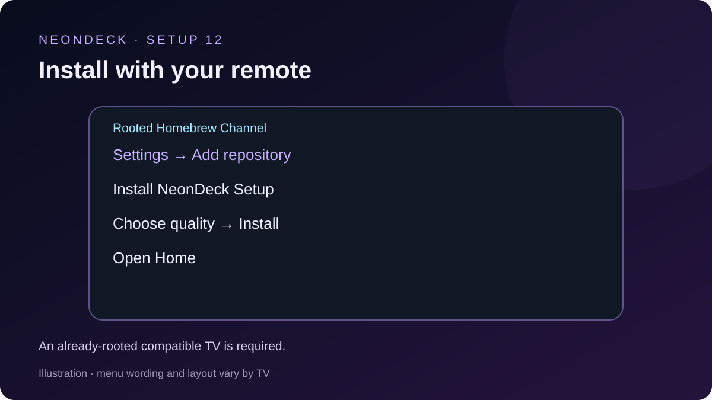
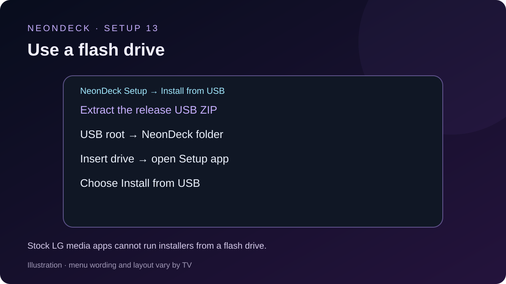

# Install with the TV remote

This route needs **a compatible TV that is already rooted with Homebrew Channel**. Stock webOS cannot run a program from a flash drive through its normal media browser. Rooting remains a model/firmware-specific prerequisite. [LG's explanation](https://forum.webostv.developer.lge.com/t/touch-screen-kiosk/27903) and the [root compatibility checker](https://cani.rootmy.tv/) describe that boundary.

## TV-only installation



1. Open **Homebrew Channel → Settings → Add repository**.
2. Enter this repository address:

   ```text
   https://github.com/helldragonpz/neondeck-webos/releases/latest/download/apps.json
   ```

3. Find **NeonDeck Setup**, choose **Install**, then open it.
4. If the reviewed baseline is missing, choose **Baseline setup** to install the included CleanYourTV Manager. Open that manager, run its setup and enable its Home takeover, then return to NeonDeck Setup. Initial baseline setup may briefly restart system components; finish any viewing first. Existing configured TVs skip this step.
5. Choose the maximum wallpaper quality and **Install / update NeonDeck**. Compatibility is checked before changes. The first installation downloads and checks the video converter using the TV's internet.
6. Wait for **NeonDeck installed**, then choose **Open Home**. Your saved wallpapers and preferences are kept.

No SSH client or Python is required for this route. Homebrew Channel supplies root access to the installed setup app. The app supports an aarch64 kernel and Node 16.20+ with the reviewed CleanYourTV baseline; see [Compatibility](COMPATIBILITY.md).

## USB installation or repair



1. Download **NeonDeck-0.3.0-USB.zip** from the release and extract it so the flash drive contains a folder named **NeonDeck**.
2. Insert it into the TV. Open the already-installed **NeonDeck Setup** app.
3. Choose **Install from USB**, wait for completion, then **Open Home**.

The setup app checks the USB payload against the checksum built into the same release. Keep the setup app and USB bundle versions matched. The first converter download still needs internet if the verified converter is not already present. USB media must use a filesystem the TV mounts; the app searches mounted USB volumes rather than requiring a particular drive letter.

**First installation on a stock TV is not USB plug-and-run.** The ZIP contains the setup IPK for owners who already have a tool capable of installing local webOS packages, but LG's normal USB video/music player cannot install it. The TV-only Homebrew repository route above is the supported bootstrap.

## Recovery

Your pre-install UI/configuration backup stays on the TV. [Recovery](RECOVERY.md) explains rollback. Removing the setup app alone does not remove the installed Home overlay or saved wallpapers.
